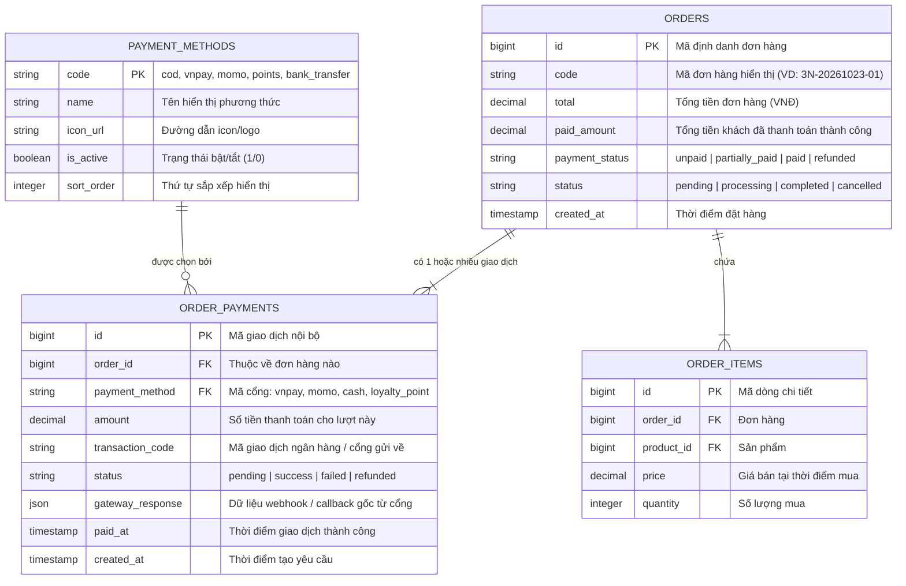

# KIẾN TRÚC THANH TOÁN ĐƠN HÀNG ĐA CỔNG (MULTI-GATEWAY PAYMENT ARCHITECTURE)

> **Dự án:** 3 Nông / Vật tư nông nghiệp 58  
> **Chủ đề:** Mô hình thực thể quan hệ (ERD) & Quy chuẩn phân tầng thanh toán đơn hàng (Split Payment / Multi-Tender)  
> **Phiên bản:** 1.0.0 (2026-10-23)

---

## 1. SƠ ĐỒ THỰC THỂ QUAN HỆ (MERMAID ER DIAGRAM)

---

## 2. Ý NGHĨA 3 TẦNG TRONG MÔ HÌNH THƯƠNG MẠI ĐIỆN TỬ CHUẨN

### Tầng 1: `payment_methods` (Danh mục cấu hình cổng thanh toán)
- Quản lý danh sách các phương thức hệ thống hỗ trợ.
- Cho phép Admin bật/tắt từng cổng thanh toán mà không cần sửa code.
- Lưu ý: Không nên đặt tên là `order_payment_methods` vì tiền tố `order_` dễ gây hiểu lầm là bảng dữ liệu của đơn hàng.

### Tầng 2: `orders` (Đơn hàng tổng thể)
- Lưu thông tin tài chính chung:
  - `total`: Tổng giá trị đơn hàng.
  - `paid_amount`: Tổng số tiền đã thanh toán thành công (tính tổng từ các giao dịch `success` trong bảng `order_payments`).
  - `payment_status`: Trạng thái tổng hợp (`unpaid` = 0đ, `partially_paid` = thanh toán một phần, `paid` = đã thanh toán đủ 100%, `refunded` = đã hoàn tiền).

### Tầng 3: `order_payments` (Nhật ký giao dịch chi tiết)
- **Bảng cốt lõi giải quyết bài toán đa cổng / thanh toán linh hoạt:**
  1. **Thanh toán kết hợp (Split Payment):** Đơn 1.000.000đ thanh toán 200.000đ bằng Điểm tích lũy (`loyalty_point`) + 800.000đ qua VNPay (`vnpay`).
  2. **Thanh toán đặt cọc (Deposit / Installment):** Đặt cọc trước 30% online qua Momo, 70% còn lại thanh toán Tiền mặt (`cash/cod`) khi nhận hàng.
  3. **Lưu vết lỗi & thử lại (Retry Logging):** Khách quét VNPay thất bại lần 1 (ghi nhận dòng `failed`), sau đó chọn quét Momo thành công lần 2 (ghi nhận dòng `success`). Không làm mất dấu vết giao dịch.
  4. **Đối soát kế toán & Hoàn tiền (Refunds):** Biết chính xác từng đồng tiền đã đi qua tài khoản hay cổng thanh toán nào khi cần đối soát hoặc hoàn tiền.
