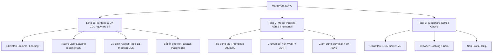

# KẾ HOẠCH NÂNG CẤP HIỆU NĂNG & TRẢI NGHIỆM KHI MẠNG YẾU (SLOW NETWORK OPTIMIZATION PLAYBOOK)

> **Mục tiêu:** Đảm bảo trải nghiệm mua sắm mượt mà, chuyên nghiệp ngay cả khi khách hàng truy cập website bằng kết nối mạng chập chờn, 3G/4G sóng yếu hoặc thiết bị cấu hình thấp.

---

## 1. Bối cảnh & Nguyên nhân cốt lõi

### Hiện tượng thực tế
- Khi vào trang chủ ở vùng mạng yếu (3G/4G hoặc wifi chập chờn): các sản phẩm như *"Bê Rút Xương", "Chim Trĩ"* bị để lại khoảng trống trắng tinh kéo dài 10 - 20 giây.
- Khách hàng không nhận biết được là ảnh đang tải hay web bị mất ảnh/bị lỗi, dẫn đến tỷ lệ thoát trang (bounce rate) cao.
- Khi ảnh tải xong, khung sản phẩm bị giật bung ra làm dịch chuyển toàn bộ nội dung phía dưới (lỗi **CLS - Cumulative Layout Shift** theo tiêu chuẩn Google Core Web Vitals).

### Nguyên nhân kỹ thuật
1. **Chưa có Lazy Loading:** Toàn bộ hàng chục hình ảnh từ đầu trang đến cuối trang bị tải dồn dập cùng 1 lúc ngay khi mở web, làm nghẽn toàn bộ băng thông mạng yếu.
2. **Thiếu cơ chế Skeleton / Placeholder Shimmer:** Thẻ `figure` chứa ảnh không có kích thước cố định (`aspect-ratio`) và không có hiệu ứng nạp mờ để báo hiệu cho người dùng.
3. **Dung lượng ảnh gốc nặng:** Nhiều ảnh sản phẩm được upload trực tiếp từ máy ảnh/điện thoại ở độ phân giải lớn (1200px - 2000px, dung lượng 500KB - 3MB) thay vì kích thước thumbnail hiển thị thực tế (~300px, 20KB - 40KB).
4. **Chưa áp dụng CDN:** Ảnh phục vụ trực tiếp từ hosting đơn lẻ, chưa có mạng lưới máy chủ phân phối nội dung (CDN) đệm tại Việt Nam.

---

## 2. Lộ trình nâng cấp 3 Tầng

---

### TẦNG 1: Tối ưu Trải nghiệm Frontend & UX (Triển khai ngay)

| Hạng mục | Giải pháp kỹ thuật | Hiệu quả mang lại |
| :--- | :--- | :--- |
| **Skeleton Shimmer** | Thêm lớp phủ Gradient nhấp nháy động trên khung `figure` | Khách biết web đang tải nội dung, giao diện hiện đại như Shopee/Tiki. |
| **Cố định tỉ lệ 1:1** | Thêm CSS `aspect-ratio: 1 / 1; width: 100%;` | Giữ khung cố định, không còn hiện tượng nhảy trang hay giật chữ. |
| **Native Lazy Loading** | Gán `loading="lazy"` & `decoding="async"` trên toàn bộ ảnh dưới màn hình | Tiết kiệm 70% dữ liệu ban đầu, dồn toàn bộ băng thông cho phần nhìn thấy trước (Above-the-fold). |
| **LCP Optimization** | Banner đầu trang dùng `loading="eager"` & `fetchpriority="high"` | Tải khung hình chính đầu tiên nhanh gấp 2 lần. |
| **Fallback onerror** | Gán `onerror="this.src='/assets/images/placeholder.png'"` | Nếu mạng rớt gói tin timeout, hiển thị logo 3Nông thay vì ô trống vỡ hình. |

---

### TẦNG 2: Media Pipeline & Nén Ảnh Tự Động (Backend / Admin)

1. **Pipeline Upload Ảnh thông minh:**
   - Khi Admin đăng tải bất kỳ ảnh sản phẩm nào lên hệ thống:
     - Tự động lưu 1 bản gốc an toàn.
     - Tự động nén và sinh bản **Thumbnail 300x300px (WebP)** cho danh sách sản phẩm.
     - Tự động nén và sinh bản **Medium 600x600px (WebP)** cho trang chi tiết sản phẩm.
2. **Hiệu quả:**
   - Dung lượng 1 ảnh giảm từ **2.5 MB** xuống còn **~25 KB** (nhẹ hơn **100 lần**).
   - Ngay cả ở mạng 2G/3G chập chờn chỉ mất 0.2s để tải xong ảnh.

---

### TẦNG 3: Hạ tầng, CDN & Bộ nhớ đệm (Hosting & Server)

1. **Kích hoạt Cloudflare CDN miễn phí:**
   - Trỏ DNS qua Cloudflare với chế độ Proxy (đám mây cam).
   - Kích hoạt tính năng **Auto Minify**, nén **Brotli** và nạp qua mạng lưới máy chủ CDN tại TP.HCM & Hà Nội (Viettel/VNPT data center).
2. **Cấu hình Browser Caching qua `.htaccess` / Nginx:**
   - Thiết lập header `Cache-Control: public, max-age=31536000, immutable` cho ảnh (`.webp`, `.jpg`, `.png`, `.svg`) và font chữ.
   - Khi khách truy cập lần thứ 2, tốc độ hiển thị là **tức thì (0 giây)** do dữ liệu đã được lưu trữ sẵn trong máy.

---

## 3. Kế hoạch Kiểm thử (Test Plan)

1. **Mô phỏng mạng yếu (Network Throttling):**
   - Mở Chrome DevTools (`F12`) > tab **Network** > Chọn cấu hình:
     - **Slow 3G** (Tốc độ tải 500 Kbps, độ trễ 2000ms).
     - **Fast 3G** (Tốc độ tải 1.6 Mbps, độ trễ 560ms).
   - Kiểm tra xem khung xám Skeleton Shimmer có hiển thị nhấp nháy êm ái khi chưa tải xong ảnh hay không.
2. **Kiểm tra độ giật khung hình (CLS):**
   - Xác nhận khi ảnh nạp xong, các tiêu đề bên dưới và nút "Xem thêm" không bị nhảy vị trí.
3. **Kiểm tra rớt mạng (Offline / 404):**
   - Ngắt kết nối mạng hoặc thử đường dẫn ảnh sai, kiểm tra xem ảnh placeholder có tự động kích hoạt hay không.
